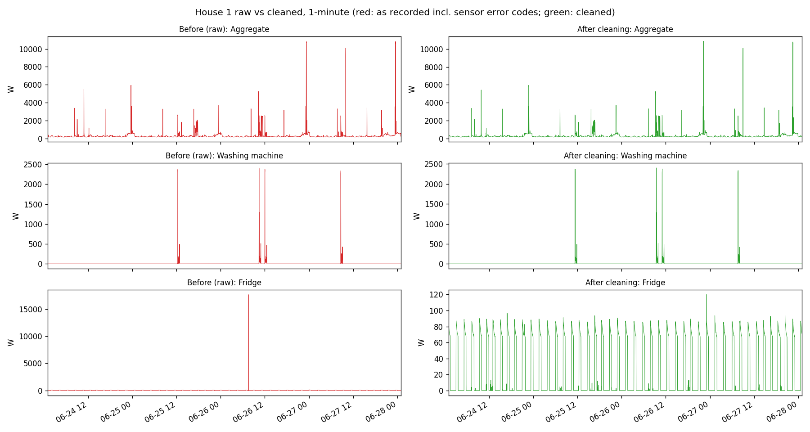
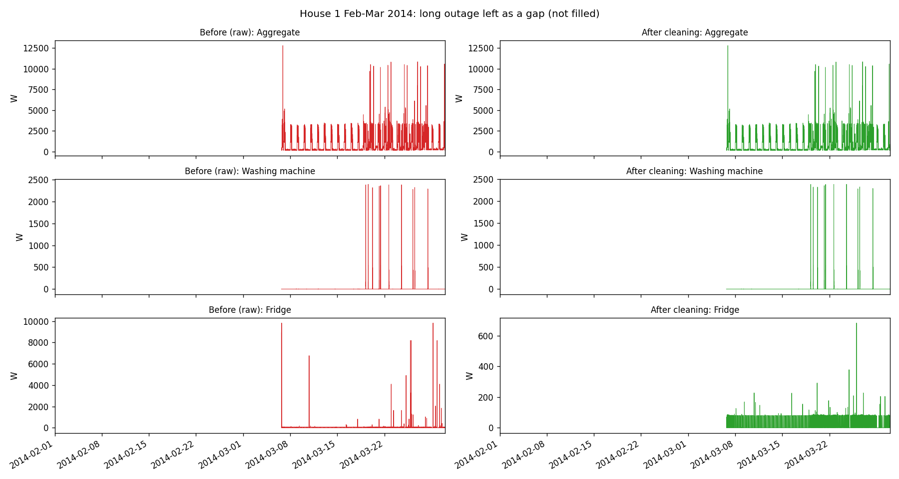

# DATA.md: coverage, quality findings and cleaning decisions

## 1. Dataset

**REFIT Electrical Load Measurements** (University of Strathclyde; Murray et al., 2017, *Scientific Data* 4:160122). CC-BY 4.0.

| | |
|---|---|
| Households | 20 homes near Loughborough, UK (numbered 1–21, there is no House 14) |
| Period | Sep 2013 – Jul 2015 (each house covers roughly 15–21 months) |
| Channels per house | 1 whole-house current clamp ("Aggregate") + 9 Individual Appliance Monitors (IAMs, plug meters) |
| Quantity / unit | Active power, **watts** |
| Native sampling | Polled every ~6–8 s. Sensors are **not synchronised**: each reading may be up to 8 s old. |
| Analysis resolution | **1 minute**, mean of the samples in each UTC minute (keeps energy totals) |

**Files used**

| Part | Files | Source archive |
|---|---|---|
| 1 (raw cleaning) | `RAW_House1_Part1.csv`, `RAW_House1_Part2.csv` | `REFIT_RAW_081116.7z` |
| 2, 3 (EDA, model) | `CLEAN_House{1,2,3,4,5,7,15,16,17,18,19,21}.csv` | `CLEAN_REFIT_081116.7z` |

> **Download note:** the `pureportal.strath.ac.uk/files/...` links in the brief return HTTP 403. The same files are served at `pure.strath.ac.uk/ws/portalfiles/portal/<id>/<name>`, and `src/get_data.py` uses those links.

**Known dataset limitations (from the readme and our checks)**
* Appliance labels describe what was plugged in *at installation*. Householders may have moved IAMs later, and the readme lists several changes.
* "Television site" and "computer site" IAMs can include several devices.
* IAMs only measure plug loads. Hard-wired loads (electric shower, oven, immersion heater) appear only in the aggregate, so they are never directly labelled.
* The cleaned files forward-fill short NaNs and replace IAM spikes above 4 kW with 0. Long outages are simply absent (no rows).
* There are periods of missing data, notably February 2014. It was caused by internet, hardware and routing failures.

---

## 2. Part 1: Raw House 1 inspection findings

Produced by `src/part1_clean_raw.py`, which writes `outputs/raw_h1_inspection.csv`.

| Check | Part1 (Oct 2013 – Oct 2014) | Part2 (Jun 2014 – Jul 2015) |
|---|---|---|
| Rows | 4,377,877 | 4,140,886 |
| Timestamp parse failures | 0 | 0 |
| Out-of-order steps | **1** (27 Oct 2013 clock change, see below) | 0 |
| Duplicate timestamps | **1,004,404** | 14,755 |
| … of which exact duplicate rows | 884,307 | 393 |
| Median / 99th pct. interval | 3 s / 15 s | 7 s / 9 s |
| Gaps > 5 min / > 1 h | 380 / 14 | 72 / 19 |
| Longest gap | **998 h (41.6 days, 24 Jan – 6 Mar 2014)** | 208 h |
| Missing cells | 0% (unavailable sensors were written as **0**) | 12.8% (written as **NaN**) |
| Aggregate > 15 kW | 82 (max 24,000 W) | 104 (max 29,159 W) |
| IAM > 4 kW | 3,038 | 911 |
| Largest IAM value | 98,301 W | 98,301 W |
| Negative values | 0 | 0 |

### Key findings

1. **The Part1 timestamps are in local time, not UTC.** Part1 was logged in UK wall-clock time but stored as if it were UTC. The evidence:
   * The only backwards step is `2013-10-27 01:59:59 → 01:00:01`, which is the autumn clock change: the hour 01:00–02:00 appears twice.
   * The 01:00 hour is missing on 30 Mar 2014 (the spring clock change).
   * When raw readings are matched to the official cleaned file, Part1 lines up at an offset of **−3600 s from April to October** and **0 s from November to March**. Part2 lines up at 0 s all year, so Part2 is already UTC.

   Ignoring this would misplace every summer reading by an hour, and it would put one autumn hour in the wrong order.

2. **The two files overlap from 27 Jun to 1 Oct 2014.** In that window they disagree: only 20% of shared timestamps carry the same aggregate value. The official cleaned file follows Part1 there.

3. **Sensor error codes.** IAM values of 4096, 8192, 16384, 32767, 65535 and 98301 W are integer-overflow or bit-error codes. A plug socket cannot deliver more than about 3 kW. Glitches also occur at lower values: for example, the washing-machine IAM reads 2048 W while the whole house is drawing 190 W.

4. **Massive duplication in Part1.** A quarter of Part1 rows repeat an earlier timestamp, and most of them are exact copies. Part2 instead spreads one poll over several partial rows, each holding a different subset of sensors with NaNs in the others.

5. **Aggregate above 15 kW.** There are 186 readings in total (up to 29 kW). They are not physically impossible for a 100 A supply, but they far exceed this home's normal peak of about 10–12 kW, which comes from short, kettle- or shower-like spikes. I treat them as invalid.

---

## 3. Part 1: Cleaning pipeline (House 1 raw → 1 minute)

Each step and its count is logged to `outputs/raw_h1_steps.csv`.

| # | Step | Rule | Effect |
|---|---|---|---|
| 1 | Parse | `Unix` column is the clock; `Time` is only its string form | 0 failures |
| 2 | Timezone | Part1: treat Unix as `Europe/London` wall time and convert to UTC. In the repeated hour the **file order** decides BST (first pass) vs GMT (second pass). Part2 is unchanged. | 2,795,917 Part1 rows shifted 1 h |
| 3 | Overlap | Use Part1 up to its last reading (1 Oct 2014 00:27 UTC) and Part2 after that. Part1 is denser in the overlap and matches the official data. | 944,950 Part2 rows dropped |
| 4 | Invalid values → NaN | IAM > 4,000 W, aggregate > 15,000 W, negative values. **NaN, not 0**, so they are not mistaken for "off". | 3,895 IAM + 171 aggregate readings |
| 5 | Sort and duplicates | Stable sort by timestamp. Drop exact duplicate rows. Rows with the same timestamp but different values are merged per column, **keeping the last non-missing value** (the most recent poll). This also re-assembles Part2's split rows. | 884,254 dropped, 131,831 merged |
| 6 | Resample | Mean per UTC minute | 920,091 minutes |
| 6b | Consistency | An IAM minute above 1.1 × aggregate + 50 W is impossible (one appliance can't use more than the whole house) → NaN. This catches glitches under 4 kW. | 3,821 IAM-minutes (2,498 on the electric heater) |
| 7 | Short gaps | Gaps of **≤ 5 min** are forward-filled. A sensor that skips a report usually means "no change", and 5 min is short compared with any appliance cycle. | 812 minutes filled |
| 7 | Long gaps | Gaps **> 5 min are left as NaN**, flagged in an `outage` column and listed in `outputs/raw_h1_outages.csv` | 408 outages, 121,355 min (13.2% of the span) |

**Outage profile:** 384 outages of 5–60 min, 12 of 1–24 h, and 12 longer than a day. The longest is 41.6 days (24 Jan – 6 Mar 2014), followed by 8.6 days (May 2015) and 7.5 days (June 2015). These are not filled because there is no defensible way to invent days of appliance behaviour. They stay NaN, and downstream steps must skip them.

**Validation against the official cleaned file** (1-minute aggregate, 797,815 shared minutes):

| | Correlation with official | Mean absolute error |
|---|---|---|
| Raw as recorded (no cleaning) | 0.768 | 89.5 W |
| **Our pipeline** | **0.997** | **4.4 W** |

So the simple pipeline reproduces the official cleaning very closely. Nearly all of the improvement comes from the timezone fix and the overlap rule.

**Figures**
* `figures/p1_before_after_week.png`: aggregate, washing machine and fridge for 4 days, before and after cleaning. Sensor-code spikes (fridge "2,000 W", washing machine "4,096 W") disappear, and the summer data moves by 1 h.
* `figures/p1_before_after_outage.png`: Feb–Mar 2014. The 41-day outage is kept as a visible gap.
* `figures/p1_daily_coverage.png`: the percentage of minutes with a reading, day by day.

**Two differences from the official pipeline.** We set invalid IAM values to NaN, where the official file sets them to 0. We also do not re-map IAMs that householders moved between appliances. That would need per-house manual review, which the brief puts out of scope.

---

## 4. Parts 2–3: Cleaned data used for the washing-machine analysis

**Houses and channels.** I used every house where the readme names a washing machine and there is no ambiguity (12 houses):

| House | WM channel(s) | Notes |
|---|---|---|
| 1 | Appliance5 | House also has a **washer-dryer** (Appliance4), which is not in the target: a confounder |
| 2, 3, 7, 15, 16, 17, 18, 19, 21 | as listed in `src/config.py` | |
| 4 | Appliance4 **+** Appliance5 | Two washing machines. The target is their **sum**, because both leave the same footprint in the aggregate. |
| 5 | Appliance3 | The model (AEG L99695HWD) is actually a **washer-dryer**, so its drying cycles look different |

Houses 8 and 9 are excluded because their "washing machine" and "washer dryer" channels are hard to tell apart. Houses 6, 10, 11, 12, 13 and 20 are excluded because the channel is missing, unlabelled (`???`) or changes part-way through. They could be added later.

**Resampling.** Mean per UTC minute of the ~8 s samples (`src/clean_data.py`). A minute with no samples stays NaN, so outages are counted, not filled. Local time (`Europe/London`) is only used for hour-of-day and weekday analysis.

**Availability and quality** (written to `outputs/wm_quality.csv`)

| House | Period | Missing minutes | Gaps > 1 h | Issues flag (all min.) | WM ≤ 20 W | Cycles | Cycles/week |
|---|---|---|---|---|---|---|---|
| 1 | 2013-10-09 → 2015-07-10 | 12.6% | 22 | 2.1% | 98.1% | 379 | 4.8 |
| 2 | 2013-09-17 → 2015-05-28 | 24.6% | 78 | 2.0% | 95.3% | 320 | 4.8 |
| 3 | 2013-09-25 → 2015-06-02 | 11.4% | 17 | 7.7% | 94.3% | 633 | 8.1 |
| 4 | 2013-10-11 → 2015-07-07 | 13.7% | 212 | 3.1% | 98.5% | 256 | 3.3 |
| 5 | 2013-09-26 → 2015-07-06 | 9.3% | 203 | 8.4% | 92.3% | 693 | 8.3 |
| 7 | 2013-11-01 → 2015-07-08 | 12.6% | 23 | 4.6% | 91.6% | 834 | 10.9 |
| 15 | 2013-12-17 → 2015-07-08 | 13.7% | 198 | 1.6% | 97.1% | 249 | 3.6 |
| 16 | 2014-01-10 → 2015-07-08 | 17.3% | 201 | 1.0% | 96.3% | 307 | 4.8 |
| 17 | 2014-03-06 → 2015-06-19 | 6.2% | 13 | 4.3% | 97.6% | 279 | 4.4 |
| 18 | 2014-03-07 → 2015-05-24 | 5.8% | 14 | 5.8% | 98.8% | 132 | 2.2 |
| 19 | 2014-03-06 → 2015-06-20 | 6.5% | 12 | 4.1% | 96.1% | 255 | 4.1 |
| 21 | 2014-03-07 → 2015-07-10 | 9.4% | 15 | 5.4% | 96.9% | 229 | 3.6 |

The washing machine is "off" (≤ 20 W) for 92–99% of available minutes. That class imbalance drives the metric choices in RESULTS.md.

### The official `Issues` flag is biased toward washing-machine use

The readme suggests discarding rows where `Issues = 1` (sum of the 9 IAMs > aggregate). We checked when it fires:

| House | 1 | 2 | 3 | 4 | 5 | 7 | 15 | 16 | 17 | 18 | 19 | 21 |
|---|---|---|---|---|---|---|---|---|---|---|---|---|
| Issues share of all minutes | 2% | 2% | 8% | 3% | 8% | 5% | 2% | 1% | 4% | 6% | 4% | 5% |
| Issues share of **WM-on** minutes | 33% | 17% | 27% | 41% | 30% | 23% | 36% | 5% | 47% | 22% | 34% | 37% |
| WM alone > aggregate (WM-on minutes) | 5.0% | 0.4% | 4.5% | 2.8% | 4.9% | 0.9% | 1.7% | 0.2% | 2.6% | 0.4% | 1.2% | 9.0% |

The flag fires **5–10× more often while the washing machine runs**. When nine unsynchronised meters are summed during a 2 kW load, a few seconds of lag easily pushes the sum above the clamp reading. Dropping flagged minutes would therefore remove a large part of the very events we want to model. **Decision:** keep flagged minutes, and exclude only minutes where the *washing machine on its own* exceeds 1.1 × aggregate + 50 W (physically impossible for the target).

---

## 5. Remaining concerns

* **Appliance re-assignment.** I trust the readme's channel labels. If an IAM was moved to another appliance part-way through, the "ground truth" is wrong for that period.
* **Back-to-back washes.** The 15-minute bridging rule merges washes run one after another into one long cycle (see House 5 and House 21 in `p2_detected_cycles.png`). This inflates per-cycle duration and energy and lowers cycle counts somewhat.
* **Washer-dryers** (House 5, and the confounding one in House 1) have drying phases that do not look like washing.
* **Unlabelled big loads.** Electric showers, ovens and immersion heaters are in the aggregate but never metered. They are the main source of false positives (see RESULTS.md).
* **Part1 zeros.** Before Part2, unavailable sensors were written as 0, so in Part1 "off" and "not reporting" cannot be told apart. This mainly affects IAM channels, because the aggregate is almost never 0.
