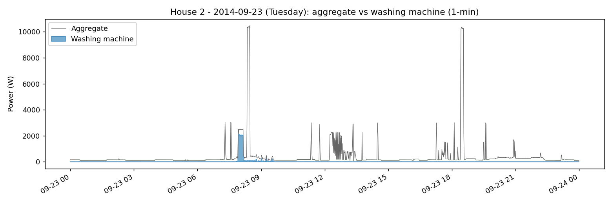
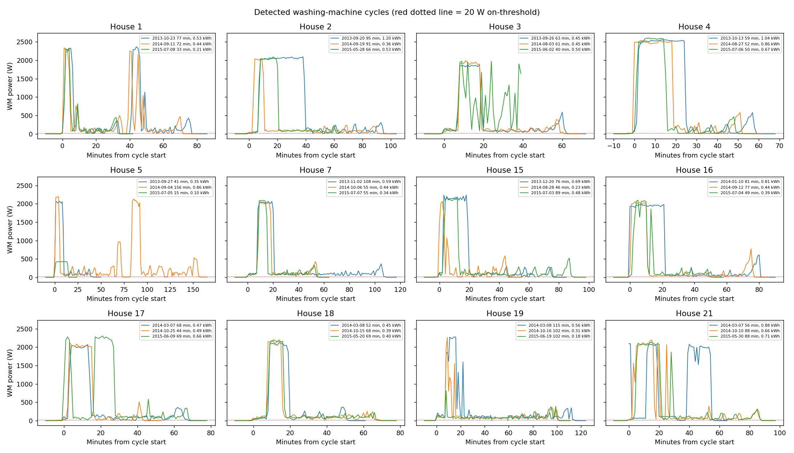
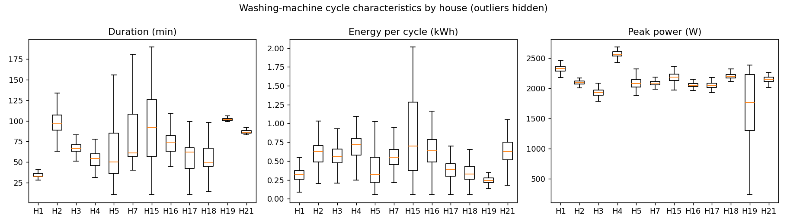
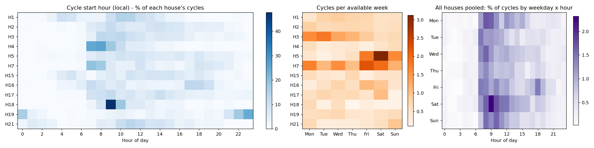
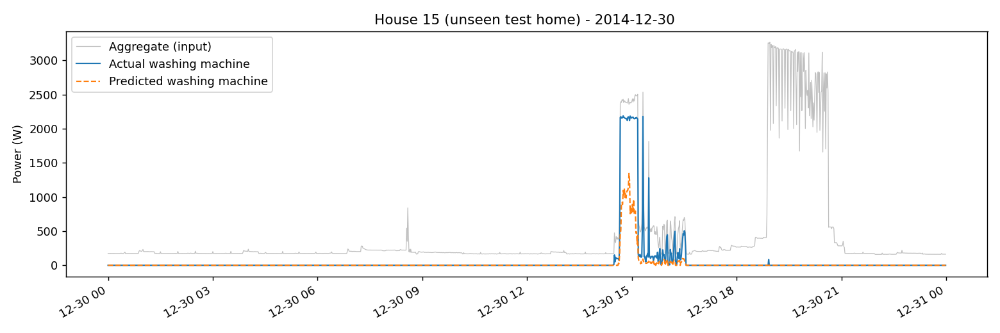
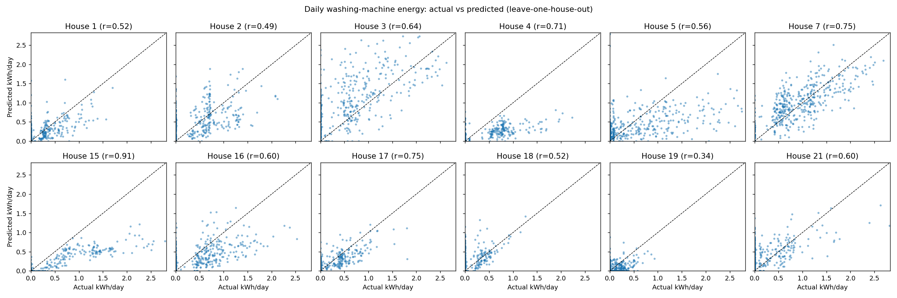
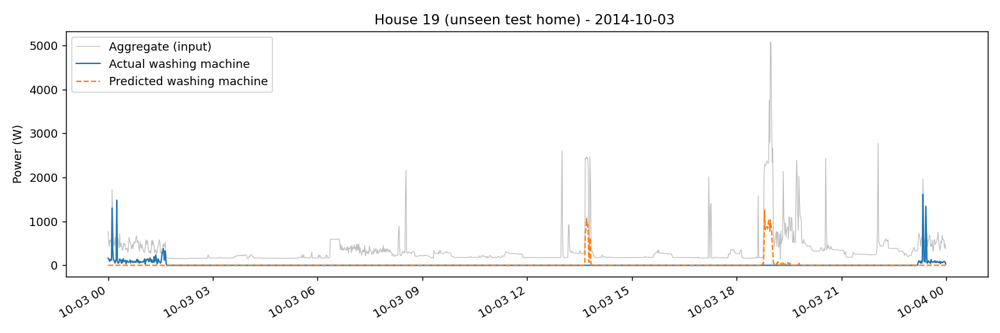
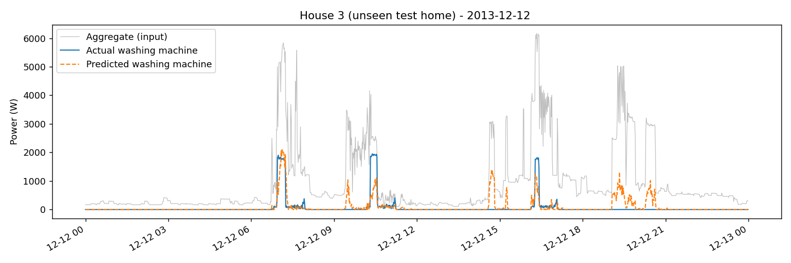

# Results: washing-machine analysis and model

Everything here uses the official cleaned REFIT data at 1-minute resolution, for 12 homes (Houses 1, 2, 3, 4, 5, 7, 15, 16, 17, 18, 19 and 21) over their full recording periods between September 2013 and July 2015. The exact dates for each home are in DATA.md. Between them, these homes ran 4,566 washes that my rule picked up. Every number below comes out of `python run_all.py`.

---

## Part 2: How the washing machines are used

### How I decide a wash is happening

In plain terms:

> The machine counts as running in any minute where its average power is above 20 W, comfortably above standby, which is a few watts at most.
>
> A wash has quiet stretches while it soaks, drains or pauses between tumbles. So if the machine stops for 15 minutes or less and then starts again, I treat that as the same wash.
>
> To count as a real wash, a run has to last at least 10 minutes, use at least 0.05 kWh and reach at least 200 W at some point. That filters out little blips like the door lock clicking or the display waking up.

The 20 W cut-off is in line with what other NILM work uses for washing machines (for example Kelly and Knottenbelt, 2015). The code is in `src/cycles.py` and the numbers are in `src/config.py`.

### Coverage and data quality

The full table is in DATA.md. In short:

- Each home has 15 to 21 months of data, with 6% to 25% of minutes missing. House 2 is the patchiest, with 78 gaps longer than an hour and one gap of 62 days.
- The washing machine is off (20 W or less) for 92% to 99% of the time. In most homes it reads exactly 0 W when off, though House 5's machine sits at a few watts on standby.
- Homes run anywhere from 2.2 washes a week (House 18) to 10.9 (House 7). The washing machine uses 0.12 to 0.91 kWh a day, which is 1% to 7% of each home's total.

### A typical day

This is House 2 on Tuesday 23 September 2014. I chose it because the data is complete for the whole day and the wash uses a typical amount of energy for that home.

The wash starts just before 8am. It begins with about 10 minutes at around 2 kW, which is the heating element warming the water and where most of the energy goes. After that comes a long, low tail of 50 to 300 W as the drum turns, rinses and spins. The same day also has two short bursts of about 10 kW (most likely an electric shower) and several 3 kW spikes that look like a kettle.

What this tells me is that a wash's energy is dominated by one block of heating, and that block looks a lot like plenty of other appliances. The long tail is what makes a wash recognisable, but it's small next to everything else going on in the house.

### Examples of detected washes

These are three washes from each home (the earliest, one from the middle and the latest), lined up by start time. Nearly all of them share the same shape: a block at 1.8 to 2.6 kW for 5 to 25 minutes, then 30 to 80 minutes of low motor activity.

A few show two heating blocks. Those are either hotter or longer programmes, or two washes run back to back that my 15-minute rule merged (House 5 on 4 September 2014, House 21 on 7 March 2014). House 19 stands out: its machine heats in short bursts instead of one solid block, which turns out to matter a lot for the model.

### Comparing homes

| House | Washes | Typical length (min) | Typical energy (kWh) | Typical peak (W) | Share at weekends | Most common start time |
|---|---|---|---|---|---|---|
| 1 | 379 | 33 | 0.32 | 2,327 | 23% | 10am |
| 2 | 320 | 97 | 0.63 | 2,091 | 24% | 9am |
| 3 | 633 | 66 | 0.56 | 1,929 | 16% | 10am |
| 4 | 256 | 54 | 0.72 | 2,556 | 36% | 8am |
| 5 | 693 | 50 | 0.32 | 2,076 | 58% | 10am |
| 7 | 834 | 61 | 0.55 | 2,083 | 29% | 7am |
| 15 | 249 | 92 | 0.70 | 2,181 | 29% | 11am |
| 16 | 307 | 74 | 0.64 | 2,050 | 30% | 5pm |
| 17 | 279 | 62 | 0.39 | 2,046 | 28% | 9am |
| 18 | 132 | 49 | 0.33 | 2,191 | 15% | 9am |
| 19 | 255 | 102 | 0.24 | 1,759 | 29% | 11pm |
| 21 | 229 | 86 | 0.63 | 2,145 | 43% | 11am |

"Typical" means the median. Peak power barely varies, sitting around 2 kW in almost every home, because that's set by the heating element. Length and energy per wash vary about threefold between homes. House 1's machine runs short, light programmes (about 33 minutes and 0.32 kWh), while House 4 averages 0.72 kWh a wash.

So the programme people pick, mostly how hot they wash, matters about as much as how often they wash. A home doing a few hot washes can easily use more than one doing lots of cool ones.

### When people wash

Across all homes, 44% of washes start between 7am and noon, with the busiest time being 8 to 10am, and there's a smaller bump in the early evening between 5 and 7pm. Two homes are very different:

- House 19 starts 58% of its washes between 10pm and 1am.
- House 1 starts 21% of its washes between 3am and 6am.

Both look like people using the delay timer, probably to make the most of a cheaper night-time rate such as Economy 7.

By day of the week, most homes are fairly even. House 5 does most of its washing from Friday to Sunday (58% at weekends), while Houses 3 and 7 wash most at the start of the week. The single busiest slot across everyone is Saturday at 9am.

---

## Part 3: Estimating washing-machine use from the whole-house meter

### What the model has to do

Given only the whole-house reading, estimate how much power the washing machine is using each minute. I used all 12 homes over their full periods, which comes to 8.4 million usable minutes after removing minutes with missing data or impossible washing-machine readings.

### The model

The core idea comes from sequence-to-point learning (Zhang et al., 2018): to estimate the washing machine at a given minute, look at a window of whole-house readings around it, so the model can see how a wash starts and how it ends. Zhang and colleagues used a neural network. I used XGBoost on features built from the window instead, because it's faster, easier to explain, and model complexity isn't what's being assessed here.

The features all come from the whole-house reading in a window from 30 minutes before to 30 minutes after:

- the readings themselves at 2-minute steps;
- how far above its usual background level the house is, which takes out the difference between homes with more or less always-on load;
- rolling averages, spreads, minimums and maximums over 5 to 61 minutes;
- how much of the window is spent above 1.5 kW;
- how jumpy the signal is;
- the hour of day and whether it's a weekend. I test whether these help further down.

The washing machine is off most of the time, so for training I keep every minute within an hour of a real wash and a random 10% of all the others. Those other minutes count ten times as much, so the model still learns the true balance between on and off.

After predicting, I clip the estimate so it can't be negative or exceed the whole-house reading, set anything under 20 W to zero, and then keep only predictions that form something that looks like a full wash under the same rule as Part 2. That last step removes lots of short false alarms.

### How I tested it

I used leave-one-house-out testing. Each of the 12 homes takes a turn as the test home. While it's the test home, it isn't used for training, for deciding when to stop training, or for choosing any setting. Within the 11 training homes, I hold back the last 20% of each home's timeline to decide when to stop training.

The reason this matters: two neighbouring minutes share 60 out of 61 minutes of their windows. Shuffle the data randomly and you get near-identical examples in both training and test, which makes a model look much better than it really is. Testing on a home the model has never seen avoids that completely. It's also the realistic situation for a utility: a new customer with only a smart meter and no appliance monitors.

### What I compared it against

- **Always off:** predict 0 W every minute. Because the machine is off over 90% of the time, this is surprisingly hard to beat on simple per-minute error.
- **Typical weekly pattern:** for each hour of each day of the week, the average washing-machine power across the training homes. It knows roughly when people tend to wash, but nothing about the actual house.

### How I measured it, and why

| Measure | Why it's useful |
|---|---|
| Daily energy error (kWh per day) | How far off the estimated washing-machine energy is each day. This is closest to what a bill insight needs. |
| Total energy error (%) | Whether the model tends to over- or under-estimate over the whole period. |
| Share of washes caught, and share of predicted washes that are real | What you need to trust anything based on counting or timing washes. |
| Minute-by-minute F1 (on means over 20 W) | Whether it gets the on/off state right each minute. |
| Average error per minute, overall and while running | The standard measure in this field. It's dominated by the off time and favours "always off", so I report it but don't rely on it alone. |

### Results averaged over the 12 unseen homes

| Model | Daily energy error (kWh/day) | Total energy error (avg. size) | Minute F1 | Washes caught | Predicted washes that are real | Avg. error per minute (W) | Avg. error while running (W) |
|---|---|---|---|---|---|---|---|
| Always off | 0.336 | 100% | 0.00 | 0% | n/a | **16.3** | 463 |
| Typical weekly pattern | 0.384 | 71% | 0.10 | 0% | n/a | 31.2 | 440 |
| XGBoost | 0.249 | **40%** | 0.39 | 81% | 39% | 21.9 | **313** |
| **XGBoost + wash filter (final)** | **0.242** | **40%** | **0.43** | **81%** | **39%** | 20.5 | 318 |
| Final, without time-of-day features | 0.244 | 44% | 0.42 | 80% | 38% | 21.1 | 322 |

And for each home, using the final model:

| Test home | Actual kWh | Predicted kWh | Total error | Daily error: model | Daily error: always off | Minute F1 | Washes caught | Predicted washes that are real |
|---|---|---|---|---|---|---|---|---|
| 1 | 127 | 120 | -5% | 0.15 | 0.20 | 0.35 | 81% | 42% |
| 2 | 195 | 220 | +13% | 0.25 | 0.32 | 0.35 | 91% | 26% |
| 3 | 322 | 520 | +62% | 0.45 | 0.52 | 0.49 | 89% | 36% |
| 4 | 185 | 80 | -57% | 0.21 | 0.29 | 0.59 | 98% | 59% |
| 5 | 344 | 214 | -38% | 0.42 | 0.53 | 0.21 | 64% | 27% |
| 7 | 470 | 497 | +6% | 0.27 | 0.76 | 0.62 | 98% | 49% |
| 15 | 196 | 82 | -58% | 0.21 | 0.34 | **0.81** | 86% | **88%** |
| 16 | 206 | 161 | -22% | 0.26 | 0.38 | 0.36 | 92% | 37% |
| 17 | 106 | 94 | -11% | 0.14 | 0.23 | 0.55 | 91% | 45% |
| 18 | 48 | 97 | +103% | 0.15 | 0.11 | 0.38 | 90% | 25% |
| 19 | 65 | 35 | -46% | 0.12 | 0.14 | 0.19 | **17%** | 16% |
| 21 | 106 | 171 | +62% | 0.26 | 0.22 | 0.24 | 78% | 20% |

Adding up all 12 homes, the predicted washing-machine energy comes within 3% of the real total, because the over- and under-estimates largely cancel out.

### What I take from this

The model beats both baselines on everything a utility would actually care about. Daily energy error is 28% lower than "always off" and lower in 10 of the 12 homes. It catches 81% of real washes in homes it has never seen before, and its minute-by-minute F1 is four times that of the typical weekly pattern.

The one measure where "always off" wins is average error per minute (16 W against 21 W). That's expected: when the machine is off 92% to 99% of the time, every false alarm costs more than simply predicting zero everywhere. It's a well-known weakness of that measure for appliances that are rarely on, and it's why I don't lead with it.

The real weakness is false alarms. Only about 39% of the washes the model reports are real, because other heating appliances produce the same kind of 2 kW block. For a single home, the total energy estimate can be off by 50% to 100% either way. So this model is better suited to grouped or ranked insights than to quoting an exact figure to one customer.

Taking away the hour and weekend features barely changes anything (F1 goes from 0.43 to 0.42). The model is recognising what a wash looks like in the whole-house signal, not memorising when people tend to wash, which is why it holds up in new homes. The features it leans on most (`outputs/model_feature_importance.csv`) are how far above background the house is, the 5-minute minimum (which separates a sustained load from a quick spike), and how long the house spends above 1.5 kW over 15 to 61 minutes.

The wash filter mainly removes made-up energy. The average total error moves from 16% too high to almost exactly right (+0.6%), and minute F1 improves from 0.39 to 0.43.

### Actual vs predicted on homes the model hasn't seen

A good example is House 15 on 31 January 2015 (`figures/p3_actual_vs_pred_h15.png`). The model gets the heating block and its timing almost exactly right. It partly misses the low tail afterwards, which is why House 15's energy comes out too low overall.

Here is daily energy for every test home (`figures/p3_daily_energy_scatter.png`); a perfect model would put every point on the dashed line. The model separates washing days from non-washing days well in most homes (correlations of 0.5 to 0.86), but it pulls the big washing days down towards the middle.

### Where it goes wrong

**1. A washing machine that doesn't look like the others (House 19).** See `figures/p3_actual_vs_pred_h19.png`. This machine heats in short 1.3 to 1.6 kW bursts rather than one long 2 kW block, and mostly runs at night. None of the 11 training homes has a machine like it, so the model misses 83% of its washes. On the same day, it also mistakes two 2.4 kW blocks from something else, probably a dishwasher or oven, for washes (at about 1:40pm and 6:45pm). An unusual machine in a new home is the biggest risk for this kind of model. A few confirmed washes from that home, or simply asking the customer "did you do a wash today?", would help more than anything else.

**2. Busy homes with lots of heating appliances (Houses 3 and 21, both 62% too high).** See `figures/p3_actual_vs_pred_h3.png`. When the house is full of 2 to 6 kW loads, such as showers, cookers, tumble dryers or a dishwasher heating up, some of them get labelled as washes. Real washes that overlap another big load get underestimated, because the heating block is buried inside something bigger. House 1 has a related problem: its washer-dryer isn't part of the target, but it produces genuinely wash-like cycles, so when the model spots them correctly they still count as false alarms.

### Papers I drew on

| Paper | What I took from it |
|---|---|
| Murray, Stankovic and Stankovic (2017), *An electrical load measurements dataset of United Kingdom households from a two-year longitudinal study*, Scientific Data 4:160122 | How the dataset was collected, the limits of the plug monitors, and the "Issues" flag, which I then tested and decided not to rely on |
| Zhang, Zhong, Wang, Goddard and Sutton (2018), *Sequence-to-point learning with neural networks for non-intrusive load monitoring*, AAAI | Estimating the appliance at the middle of a window of whole-house readings, and testing on REFIT homes the model hasn't seen |
| Kelly and Knottenbelt (2015), *Neural NILM: Deep neural networks applied to energy disaggregation*, ACM BuildSys | A per-appliance "on" threshold (about 20 W for washing machines), training on windows weighted towards real activations, and reporting both energy and on/off measures |
| Makonin and Popowich (2015), *Nonintrusive load monitoring (NILM) performance evaluation*, Energy Efficiency 8 | Why accuracy and per-minute error are misleading for rarely used appliances, and why energy-based and on/off-based measures should be reported together |
| D'Incecco, Squartini and Zhong (2019), *Transfer learning for non-intrusive load monitoring*, IEEE Transactions on Smart Grid | That testing on other houses is the realistic test, which is why I chose leave-one-house-out |

### What I'd try next

1. A second step that looks at each predicted wash as a whole (how long it lasts, how much energy it uses, the shape of its tail, time since the last wash) and decides whether it's real. This goes straight at the false alarms, and I'd test it the same way.
2. A Seq2Point neural network on the same test setup, to see whether it picks up the quiet tail end of a wash better than my hand-made features.
3. Bringing in the remaining REFIT homes (6, 8, 9, 10, 13 and 20) after checking their labels by hand, so the model sees more kinds of machine.
4. Giving a range rather than a single number, for example for monthly washing-machine energy, so a utility can choose to show an insight only when the model is confident.
